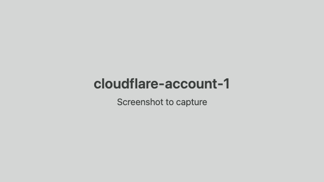
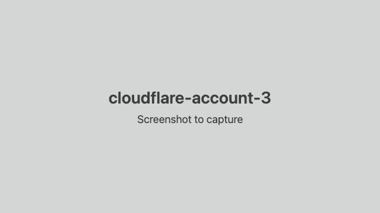

# Sign up for Cloudflare

Why: the bridge runs on Cloudflare (a Worker), and the free plan is enough.

1. Open https://dash.cloudflare.com/sign-up.

   

2. Enter your email and a password, click Sign up, then open the email Cloudflare sends you and click its verify link.

   

3. When the dashboard asks what you want to do first, skip it: you land on the account home page, and the Free plan is already active.

   

4. Back here, sign wrangler in to the new account: `npx wrangler login`.
