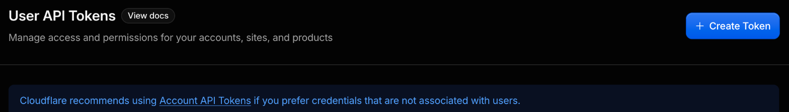
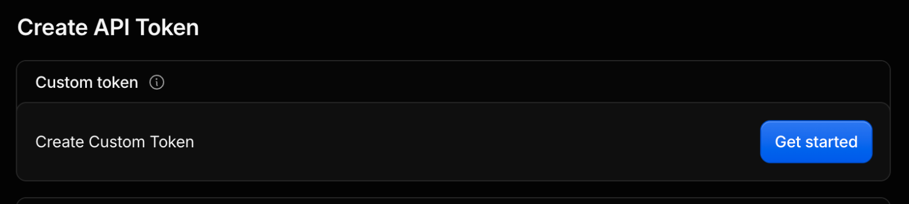
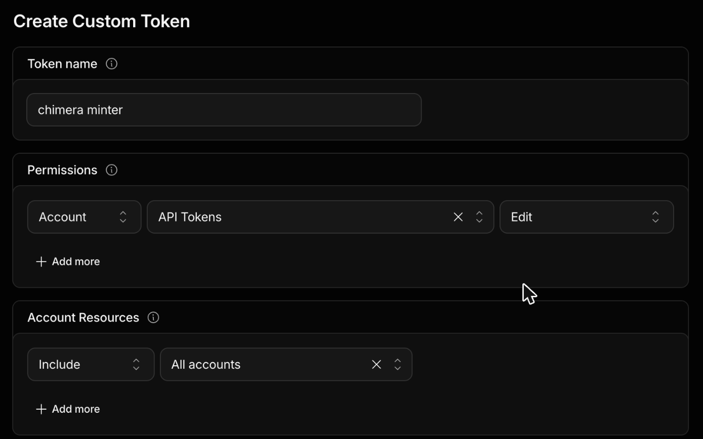
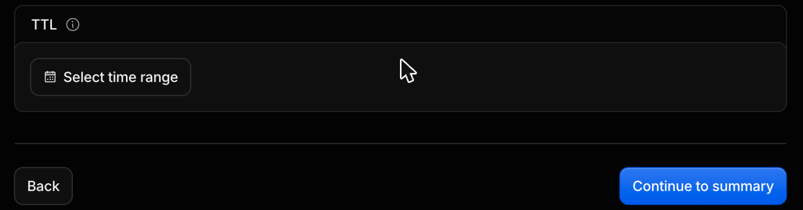

# Create the master token

Why: one token with only "API Tokens: Edit" lets `secrets:mint` make every other token, so you create one token by hand and paste it once.

1. Open https://dash.cloudflare.com/profile/api-tokens (Cloudflare dashboard > My Profile > API Tokens).

   

2. Click Create Token, then Create Custom Token > Get started.

   

3. Give it a name, such as "chimera minter", and add one permission: Account / API Tokens / Edit. Nothing else. Under Account Resources, include your account (All accounts also works).

   

4. Under TTL, click Select time range and set the end date one year from today.

   

5. Click Continue to summary, then Create Token.

6. Copy the token into your password manager now (Cloudflare shows it once), then run `pnpm secrets:mint -- --deployment <id>` in your own terminal and paste it at the hidden prompt.
