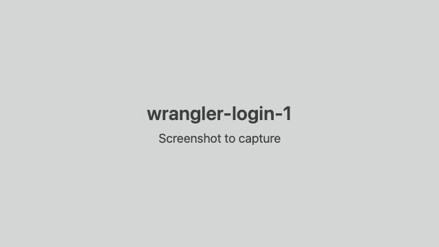

# Log wrangler in to Cloudflare

Why: wrangler is Cloudflare's command-line tool; setup uses its login to find your account and domains, and to deploy.

1. In this folder, in your terminal, run `npx wrangler login`. It opens your browser.

2. In the browser, check the account is the one that should run the bridge, then click Allow.

   

3. Wait for the browser to say you can close the page, and for the terminal to print "Successfully logged in".

   

4. Run the check again: the "Check again" button on the setup page, or `pnpm run setup -- --prereqs`.
