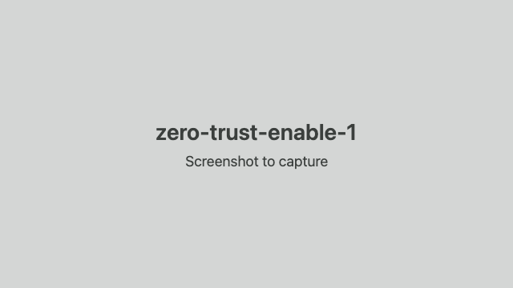
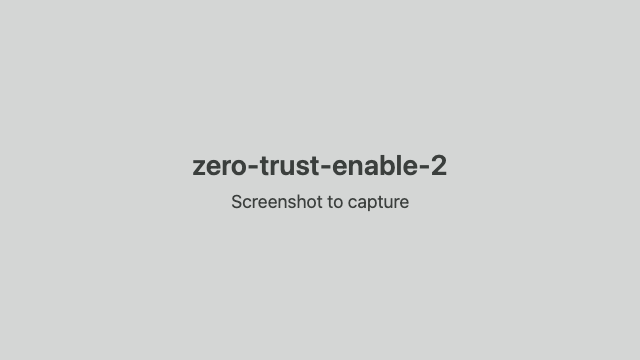
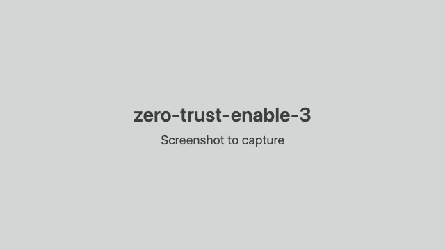

# Turn on Cloudflare Access (once per account)

Why: Cloudflare Access is the free login screen people use to sign in to the bridge, and it must be switched on once before setup can create it.

1. Open https://one.dash.cloudflare.com/ and pick this account.

   

2. Choose a team name (it becomes <team>.cloudflareaccess.com) and the Free plan (up to 50 people; no charge).

   

3. Finish the checkout: the Free plan costs nothing, though Cloudflare may ask for a payment method. You land on the Zero Trust overview.

   
